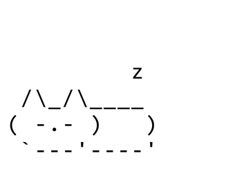
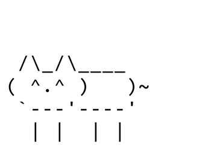
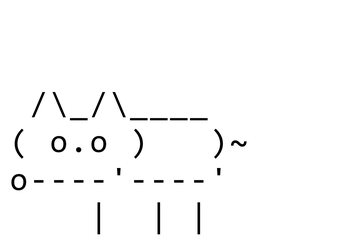
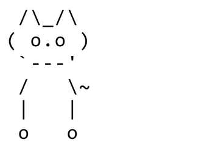
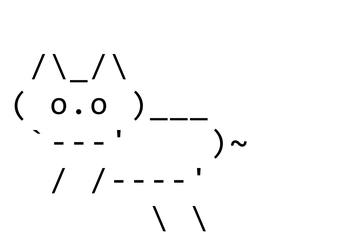
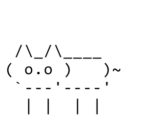

# Desktop Cat

Code written with **Codex GPT6 Astra**.

A tiny coworker. Mostly naps. Occasionally hunts your cursor.



Desktop Cat walks above the taskbar, explores exposed window tops, naps, and plays with your mouse pointer. ASCII is just the bundled art style: the app displays PNG animation frames, so your pet can use pixel art, hand-drawn artwork, or another style. The default set uses black ASCII on rounded white stickers; a transparent white-text set is also included.

## Requirements

Windows 10 or 11, x64, with .NET Framework 4.8 and a desktop session. No administrator permissions, NuGet packages, or .NET SDK installation are required. Validation has been performed on the development Windows desktop; other DPI/taskbar configurations still need testing.

## Bring your cat home

1. Download the repository using **Code → Download ZIP**, or clone it with Git. You can also download the source ZIP from a release.
2. Extract the ZIP into a writable folder, keeping the `prototype` and `art` folders together with **Start Cat.cmd**.
3. Double-click **Start Cat.cmd**. The first launch compiles the source automatically; later launches rebuild only when code changes.

A console briefly appears during launch. Use the tray icon's Exit command to stop the pet. Exit a running cat before launching updated code that needs a rebuild.

The repository and source release ZIP contain no executables. The launcher generates a local executable in `prototype/bin`, which Git ignores along with all other `.exe` files.

To launch from PowerShell in the project folder:

```powershell
& '.\Start Cat.cmd'
```

The launcher runs its PowerShell helper with a process-only execution-policy setting; it does not change your saved PowerShell policy. If compilation fails, the console stays open and displays the error.

## Making friends

| A little affection | Something to chase | Pick me up | A higher perch |
| :---: | :---: | :---: | :---: |
|  |  |  |  |

- Click to pet; drag to carry and release to drop.
- Move the pointer gently near the cat at its body level to attract attention, chase, or a paw swipe. Choose Playful Kitten in Personality for more frequent play.
- Right-click the cat or tray icon for personality, sprite choice, sleep/wake, pause, jumping, and exit. Double-click the tray icon to return to the taskbar floor.
- Upward jumps require an exposed platform less than five body heights above the cat, with enough room to land. Maximized windows leave the work-area floor available.

Settings and diagnostics are stored in `%LOCALAPPDATA%\DesktopCat`: `personality.json`, `sprite-set.txt`, and `last-run.log`. Existing development settings migrate on first use. Delete the two settings files to reset preferences in a packaged release.

## Give your pet a new look



Use your own **340 × 248 pixel PNG frames with transparent backgrounds**. Copy a bundled set into a new folder under `art/sprites/`, replace its artwork, and give it a `name` in `manifest.json`. Open **Sprite set** in the cat or tray menu to choose it. New sets appear when you open the dropdown, and your choice is saved for the next launch. No code changes are needed.

Follow the [custom sprite guide](art/CUSTOM_SPRITES.md) for folder locations, alignment, animation requirements, and validation. You can draw any character, though its movements and personality currently follow cat behavior.

## Validation and source packaging

From PowerShell in the project folder:

```powershell
& '.\Start Cat.cmd' --self-test
& '.\Start Cat.cmd' --cursor-test
& '.\Start Cat.cmd' --settings-test
& '.\Start Cat.cmd' --integration-test
& '.\Start Cat.cmd' --smoke-test
```

Close the normal instance before running runtime probes. Run each probe separately and inspect `%LOCALAPPDATA%\DesktopCat\last-run.log` after it finishes. The integration probe briefly creates its own test window.

Create a source-only release ZIP with `.\prototype\release.ps1`. Output goes to ignored `dist/`. The ZIP includes the launcher, source, and sprites, and contains no compiled executable. Publish source files in the repository and attach the ZIP to a GitHub Release.

## Current scope

Desktop Cat currently supports the primary monitor. Recoloring, multimonitor roaming, fullscreen hiding, toys, and saved position are planned. Mixed DPI, auto-hidden taskbars, physical drag/drop, click-through, and focus behavior need manual testing on additional devices.

Feature/design records: [features](FEATURES.md), [personality](PERSONALITY.md), [animation mapping](BEHAVIOR_ANIMATION_MAP.md), and [prototype details](prototype/README.md).

No project license has been selected yet.
